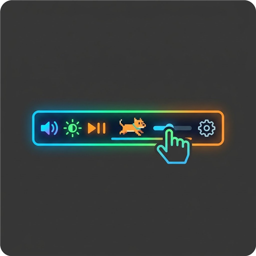

# Touch Bar for Windows (MacBook Pro Edition)

<p align="center">
  
</p>

<p align="center">
  <a href="https://github.com/Gleb200/MacBook-TouchBar-Windows/releases"></a>
  <a href="LICENSE.txt"></a>
  
  
</p>

**A feature-rich, high-performance Touch Bar host and Control Center for Apple MacBook Pro running Windows 10/11 through Boot Camp.**

Renders custom UI directly to the Touch Bar hardware framebuffer at smooth 60 FPS with zero lag, bringing native media control, intelligent audio device tracking, an adaptive running apps switcher dock with touch gestures, interactive pets, multi-source CPU thermals, and MacBook hardware integrations.

Supports all Touch Bar MacBook Pro models (13", 15", 16" from 2016 through 2020 with Apple T1 and T2 Security Chips).

---

## Key Features

### 1. Direct 60 FPS Hardware Framebuffer Rendering
* Driven by the low-level `DFRDisplayKm.sys` kernel driver and `Avalonia.DfrFrameBuffer.dll`.
* Writes directly to the USB framebuffer endpoint (`\\.\DFRDisplayKm`) at 60 FPS with minimal CPU overhead (~0.1% – 0.3%).
* Dedicated digitizer touch processing with sub-pixel touch tracking and zero-latency feedback.

### 2. Intelligent Windows Core Audio Control
* **Dynamic Audio Device Tracking (`IMMNotificationClient`):**
  Automatically monitors default audio render endpoint changes. When external speakers (e.g. JBL Link Portable, Bluetooth speaker), USB DAC, or headphones are connected or disconnected, the volume slider instantly switches to control the active device instead of remaining stuck on built-in Apple Audio Device speakers.
* **Bi-directional Real-Time Volume Sync (`IAudioEndpointVolumeCallback`):**
  Adjustments made via hardware buttons, keyboard shortcuts, or Windows taskbar flyouts instantly reflect on the Touch Bar slider.
* **Control Center Capsule Slider with Dual-Gesture Speaker Icon:**
  * **Tap Speaker Icon ($X \le 38\text{ px}$):** Toggles Mute / Unmute instantly without altering the current volume level. Icon turns red (`\uE74F`), label reads "Mute", and track dims.
  * **Swipe to Adjust:** Dragging from the left edge smoothly slides volume from 0% to 100%. Sliding up automatically unmutes the audio.

### 3. Brightness Control & Power Menu
* **Touch Bar Brightness Drawer:**
  * Smooth capsule slider for display brightness.
  * Auto-Brightness toggle button directly inside the drawer.
* **Power Management Drawer:**
  * Quick Lock (`LockWorkStation`).
  * Restart (`shutdown /r /t 0`).
  * Shut Down with two-step confirmation ("Shut Down" $\rightarrow$ "Confirm?" / "Выкл" $\rightarrow$ "Точно?") to prevent accidental taps.

### 4. Adaptive App Switcher / Dock (macOS-Style)
* **Live Running Applications:**
  Discovers top-level non-minimized desktop windows, extracts crisp high-DPI icons, and displays active window highlight indicators.
* **Window Switching & Minimizing:**
  * Tap an inactive app to bring it to the foreground (bypasses Windows foreground lock restrictions via simulated key events).
  * Tap the active app tab to minimize its window to the taskbar.
* **Adaptive Shrinking (Dynamic Tab Width):**
  Tabs dynamically scale down from 160 px down to 65 px as more apps open, preserving clean readability and icon alignment without immediately requiring scroll.
* **Horizontal Touch Scroll & Auto-Focus:**
  * Smooth horizontal pan gesture ($\ge 8\text{ px}$) with inertia to browse overflowed tabs.
  * Auto-scrolls the dock strip to always keep the foreground window visible.

### 5. 10 Interactive Companion Pets
* **10 Animated Character Skins:**
  * **Eevee, Pikachu, Charmander, Bulbasaur, Squirtle, Gengar, Snorlax, Lucario, Marisa, Reimu.**
* **Rich Animations:**
  * Walking with direction flips, idle breathing, and sleeping when the system is inactive.
  * **Music Dancing:** Characters dance whenever media playback is active!
  * **Touch Gestures:** Drag and drop pets along the Touch Bar; tap to trigger affection emotes (hearts, notes, sparks).
* **Static Pinning Mode (рџ“Њ):**
  Lock the character in place so it stays stationary and only moves when dragged with a finger.

### 6. Media Control Strip (Now Playing / SMTC)
* Deep integration with Windows System Media Transport Controls (`Windows.Media.Control`).
* Supports Spotify, Apple Music, YouTube Music, Chrome, Edge, and media players.
* Displays live Track Title, Artist, and playback controls (Previous, Play/Pause, Next).
* Smooth crossfade transition between the Dock and Media strip.

### 7. Cascading Multi-Source CPU Thermals (Auto-Fallback)
An automatic multi-source thermal engine that gracefully falls back across sensor providers without UI freezes or WMI locks on Apple T2 chips:
1. **WMF Control / Macs Fan Control (Shared Memory):**
   Reads `Local\WMF_CpuTemp`, `Global\WMF_CpuTemp`, and session mappings. Zero overhead, physical MMIO on Apple T2.
2. **LibreHardwareMonitorLib (Direct MSRs):**
   Reads Intel DTS MSRs directly via Ring0 driver with TjMax Distance filtering.
3. **Core Temp (Shared Memory):**
   Reads `CoreTempMappingObject`.
4. **AIDA64 (Shared Memory XML):**
   Reads `AIDA64_SensorValues`.
5. **Windows ACPI WMI:**
   Safe query to `MSAcpi_ThermalZoneTemperature` with an asynchronous 200 ms timeout protection.
* **Anti-Flicker Buffer:** Holds the last valid temperature for up to 3.5 seconds across transient bus misses.

### 8. MacBook Pro Hardware Integrations
* **Virtual ESC Key:**
  Essential left-aligned Escape key for 2016–2019 MacBook Pro models lacking a physical Escape key.
* **Global Fn Row (F1–F12):**
  Holding the physical `Fn` key on the MacBook keyboard flips the bar into standard F1–F12 keys.
* **System Overlays:**
  * Windows Hello / Touch ID biometric prompt banner.
  * Administrator UAC elevation dialog confirm buttons.
  * MagSafe / USB-C charging connection banner.

### 9. Fluent Windows 11 Settings Center (`TouchBarSettings.exe`)
* Modern dark-themed WPF configuration utility.
* Bilingual: full English and Russian localization.
* Widget reordering and visibility toggles.
* Live synchronization with `config.json` without requiring application restarts.

---

## Prerequisites

1. **DFRDisplayKm Driver:**
   Install the open-source Touch Bar display driver by Bingxing Wang ([imbushuo/DFRDisplayKm](https://github.com/imbushuo/DFRDisplayKm)).
   * Download the driver release package.
   * Right-click `DFRDisplayKm.inf` and select **Install**.
   * Ensure device `Apple Touch Bar Display` appears working under Device Manager.
2. **.NET Desktop Runtime:**
   * .NET Core 3.1 Desktop Runtime (x64) or included standalone runtime.
3. **Apple Boot Camp:**
   * Intel MacBook Pro (2016–2020) running Windows 10 or Windows 11 (64-bit).

---

## Installation & Quick Start

1. Download the latest **`TouchBar-Windows-v1.0.0-win64.zip`** from [Releases](https://github.com/Gleb200/MacBook-TouchBar-Windows/releases).
2. Extract the archive into a permanent folder (e.g. `C:\Program Files\TouchBar` or any user directory).
3. Right-click **`Добавить_в_Автозагрузку.bat`** and select **Run as administrator** (or launch `TouchBar.exe` directly).
   * This registers the silent Windows Task Scheduler job `TouchBarAutoStart` with highest privileges, enabling autostart on battery and without UAC prompts.
4. Launch **`Настройки_TouchBar.bat`** (or `TouchBarSettings.exe`) to configure widgets, choose your companion pet, and customize appearance.

---

## Building from Source

### Prerequisites
* Windows 10/11 x64
* [Visual Studio 2019 / 2022](https://visualstudio.microsoft.com/) or [.NET Core 3.1 SDK](https://dotnet.microsoft.com/download/dotnet/3.1)
* Workloads: `.NET desktop development`

### Build Command
```powershell
# Clone repository
git clone https://github.com/Gleb200/MacBook-TouchBar-Windows.git
cd TouchBar-Windows

# Build entire solution in Release configuration
dotnet build -c Release DFRContentHost.sln
```

Build outputs will be generated in:
* `DFRContentHost\bin\Release\netcoreapp3.0\`
* `TouchBarSettings\bin\Release\netcoreapp3.1\`
* `TouchBar\bin\Release\netcoreapp3.1\`

---

## Project Structure

```
в”њв”Ђв”Ђ Avalonia.DfrFrameBuffer/  # Low-level DFRDisplayKm driver bridge & touch digitizer
в”њв”Ђв”Ђ DFRContentHost/           # Main Avalonia UI host, Control Strip, Dock, Telemetry
в”‚   в”њв”Ђв”Ђ Assets/               # UI graphics, icons, and fonts
в”‚   в”њв”Ђв”Ђ Interop/              # CoreAudio, CpuTemperatureMonitor, NativeMethods
в”‚   в”њв”Ђв”Ђ Models/               # AppConfig, ConfigManager
в”‚   в”њв”Ђв”Ђ ViewModels/           # MainViewModel, Telemetry, Companion, SMTC
в”‚   в””в”Ђв”Ђ pets/                 # Sprite sheets for 10 companion characters
в”њв”Ђв”Ђ TouchBarSettings/         # Fluent Dark Windows 11 WPF settings application
в”њв”Ђв”Ђ TouchBar/                 # Elevated silent application launcher
в”њв”Ђв”Ђ app.ico                   # Multi-resolution application icon
в”њв”Ђв”Ђ app.png                   # High-resolution logo
в”њв”Ђв”Ђ DFRContentHost.sln        # Visual Studio solution file
в””в”Ђв”Ђ LICENSE.txt               # MIT License
```

---

## Acknowledgments & Credits

* **Bingxing Wang ([imbushuo](https://github.com/imbushuo))** for the pioneering [DFRDisplayKm](https://github.com/imbushuo/DFRDisplayKm) kernel driver and original DFRContentHost concept.
* **Avalonia UI** for the cross-platform XAML framework.
* **LibreHardwareMonitor** contributors for hardware sensor abstractions.
* **Gleb200** for the MacBook Pro Windows Touch Bar enhancements, Core Audio dynamic device switching, adaptive dock touch scrolling, multi-source thermal engine, companion pets, and settings center.

---

## License

Distributed under the [MIT License](LICENSE.txt).

